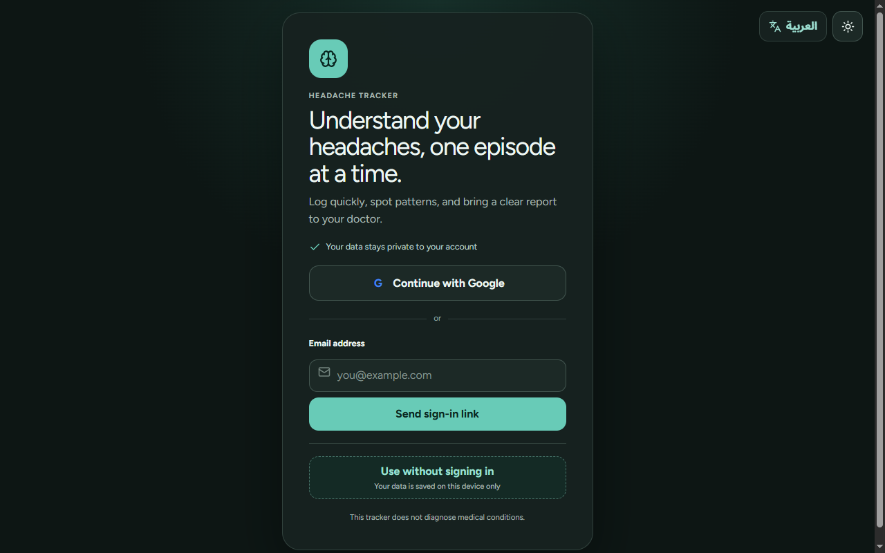
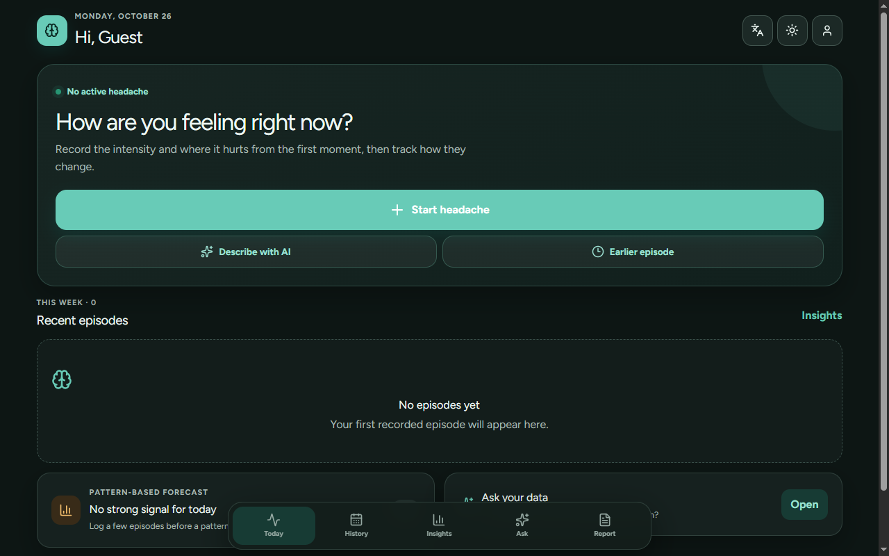
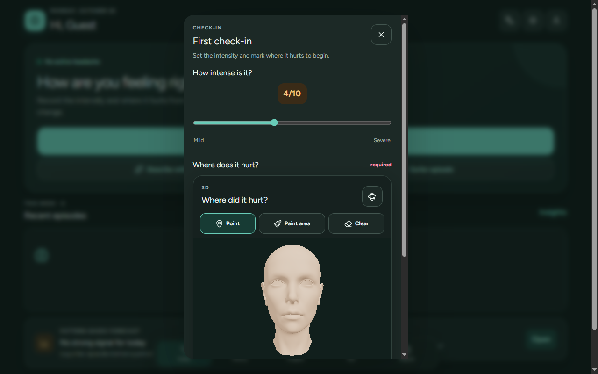
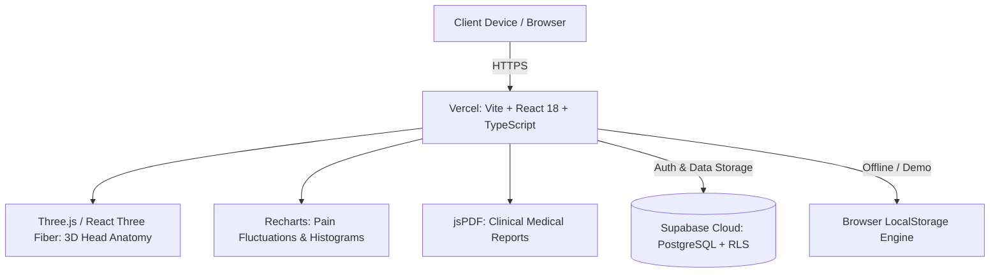

# Headache Tracker — Bilingual 3D Headache & Migraine Diary

<p align="center">
  <a href="https://headache-tracker-platform.vercel.app/" target="_blank">
    
  </a>
  
  
  
  
  
</p>

<p align="center">
  A mobile-first, clinical-grade headache and migraine diary designed to help individuals understand pain patterns and communicate clearly with healthcare providers. Built with interactive 3D anatomy mapping, pattern estimation, intelligent symptom logging, and exportable medical reports.
</p>

---

## 🌐 Live Application

- **Production URL:** [https://headache-tracker-platform.vercel.app/](https://headache-tracker-platform.vercel.app/)
- **Deployment Platform:** Vercel
- **Database & Auth:** Supabase (PostgreSQL with Row Level Security)

---

## 📸 Screenshots

<p align="center">
  
  
  
</p>

---

## ✨ Key Features

- **🧠 Interactive 3D Head Mapping:** Built with Three.js to let users rotate a 3D anatomical model and pinpoint exact pain zones (forehead, temples, crown, occipital, behind eyes, neck).
- **📈 Intensity & Duration Progression:** Record initial pain severity, ongoing fluctuations, and resolution time with interactive visual timelines.
- **💊 Treatment & Medication Tracking:** Log pharmaceuticals, natural remedies, and rest periods alongside dosage and response latency.
- **📊 Predictive Patterns & Trend Insights:** Data-driven pattern analysis showing recurring weekly spikes, duration medians, and common triggers.
- **📄 Clinical PDF Reports:** Generate clean, structured PDF summaries ready to be shared with neurologists or primary care physicians.
- **🌐 Full Bilingual Experience:** Instant seamless toggle between English (LTR) and Arabic (RTL) across all views.
- **⚡ Zero-Friction Guest Mode:** Explore all features with localized sample data without mandatory authentication.
- **🔒 Private & Secure:** End-to-end data isolation protected by Supabase Row Level Security (RLS) policies.

---

## 🏗️ Architecture Overview



---

## 🛠️ Tech Stack

| Layer | Technologies |
|---|---|
| **Frontend Framework** | React 18, TypeScript, Vite |
| **3D Graphics & Canvas** | Three.js, `@react-three/fiber`, `@react-three/drei` |
| **UI Components & Motion** | Tailwind CSS, Lucide React, Framer Motion |
| **Data Visualization** | Recharts |
| **Document Generation** | jsPDF, html2canvas |
| **Backend & Authentication** | Supabase (PostgreSQL, Row Level Security, Magic Link & Google OAuth) |
| **Hosting & CI/CD** | Vercel |

---

## 🚀 Getting Started

### Prerequisites
- Node.js (v18 or higher)
- npm or pnpm

### 1. Clone the repository
```bash
git clone https://github.com/Waelkun/headache-tracker.git
cd headache-tracker
```

### 2. Install dependencies
```bash
npm install
```

### 3. Setup environment variables
Copy the example configuration:
```bash
cp .env.example .env.local
```

Set your Supabase credentials in `.env.local`:
```env
VITE_SUPABASE_URL=https://your-project.supabase.co
VITE_SUPABASE_PUBLISHABLE_KEY=sb_publishable_your_key
```

### 4. Start development server
```bash
npm run dev
```

### 5. Run tests & production build
```bash
npm test
npm run build
```

---

## ⚠️ Medical Disclaimer

This application is an educational logging and pattern-recognition tool. It does not provide medical diagnoses or replace consultations with licensed healthcare professionals.

---

## 📄 License

Maintained by [Waelkun](https://github.com/Waelkun). All rights reserved.
